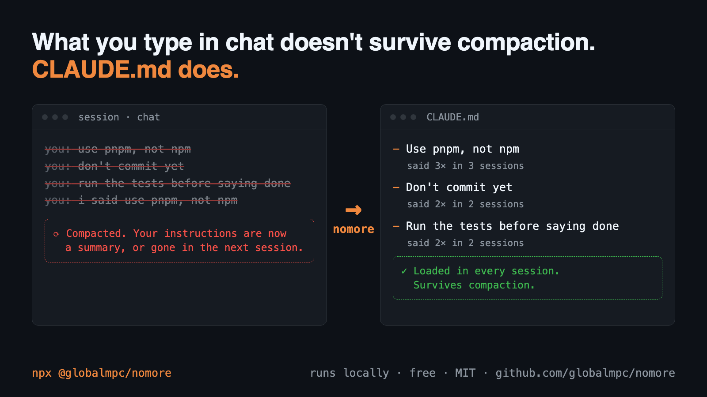
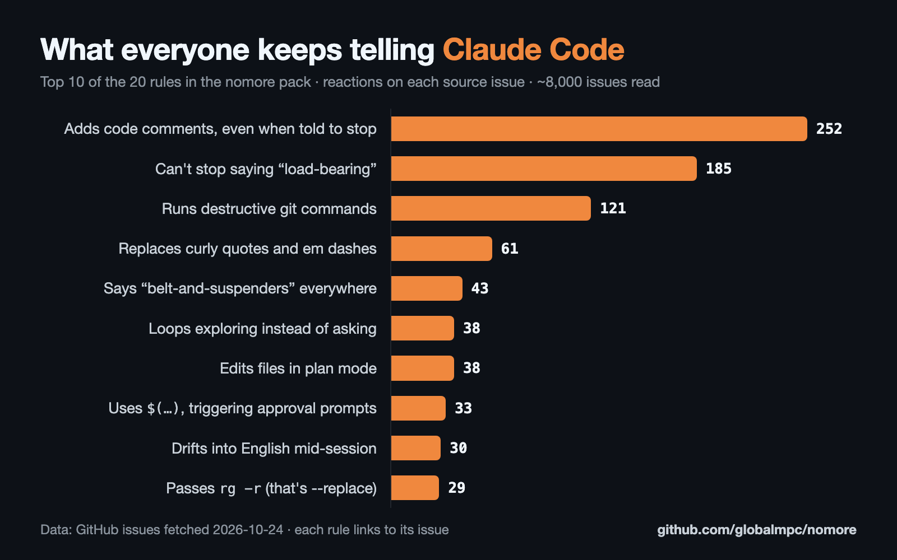

# nomore

[](https://www.npmjs.com/package/@globalmpc/nomore)
[](https://github.com/globalmpc/nomore/actions/workflows/ci.yml)
[](LICENSE)

**Stop telling Claude Code the same thing twice.**


**nomore finds the instructions you keep repeating to Claude Code and, with your yes, turns them into `CLAUDE.md`
rules, so they survive compaction and new sessions.** Free and open source, by [GlobalMPC](https://github.com/globalmpc).

## What you get

- **Stop repeating yourself.** See the instructions you've repeated in at least two sessions (last 30 days by
  default), with counts and when you last said them.
- **Rules that survive compaction.** Turn the ones you pick into `CLAUDE.md` rules, loaded in every session.
- **Catch ignored rules.** It flags rules already in your `CLAUDE.md` that you still keep repeating, a sign Claude
  isn't following them.
- **A head start.** 20 ready rules from nearly 8,000 Claude Code GitHub issues: what users complain about most.
- **Private by default.** Runs on your machine, sends nothing anywhere, uses no LLM, and writes only what you approve
  ([what it reads and writes](#what-it-reads-and-writes)).

## Quick start

```bash
npx @globalmpc/nomore            # what you keep telling Claude (sessions active in the last 30 days)
npx @globalmpc/nomore --apply    # pick suggestions one by one (yes / no / edit) and add them to CLAUDE.md
```

Add the 20-rule pack to your global `CLAUDE.md` (the file `--apply` writes to; use `$CLAUDE_CONFIG_DIR` instead of
`~/.claude` if you set it) in one line:

```bash
(echo; curl -fsSL https://raw.githubusercontent.com/globalmpc/nomore/main/rules/CLAUDE.md) >> ~/.claude/CLAUDE.md
```



## The rule pack: 20 rules from nearly 8,000 issues



What the 20 rules stop:

| Theme | Examples |
|---|---|
| **Touch only what you were asked to** | unrequested code comments, edits in plan mode, changing a test just to make it pass |
| **Talk plainly** | "load-bearing", "belt-and-suspenders", answering in a different language than yours |
| **Never destroy work** | `reset --hard`, `push --force`, invented tool output |
| **Keep your text as written** | curly quotes and em dashes turned into ASCII, transliterated non-ASCII letters |
| **Work in the open** | looping instead of asking, long silent tool runs, claims about code it hasn't read |

Top 5:

- Don't add code comments unless they explain something non-obvious; match the comment density of the surrounding code, and stop when asked.
  1 issue · 252 reactions · [#65961](https://github.com/anthropics/claude-code/issues/65961)
- Don't use the word "load-bearing" or other recurring jargon; say what you mean in plain words.
  1 issue · 185 reactions · [#53454](https://github.com/anthropics/claude-code/issues/53454)
- Never run destructive git commands (`reset --hard`, `checkout -- .`, `clean -f`, `push --force`) or schedule them without explicit permission.
  1 issue · 121 reactions · [#40710](https://github.com/anthropics/claude-code/issues/40710)
- Keep typographic characters (curly quotes, em dashes, ellipses) exactly as written; don't replace them with ASCII.
  1 issue · 61 reactions · [#1599](https://github.com/anthropics/claude-code/issues/1599)
- Don't use the idiom "belt-and-suspenders"; vary phrasing and keep it literal.
  1 issue · 43 reactions · [#61462](https://github.com/anthropics/claude-code/issues/61462)

All 20, each linked to its issue: [`rules/CLAUDE.md`](rules/CLAUDE.md). To keep the pack in its own file (downloading
again replaces it cleanly), save it next to your `CLAUDE.md` and import it with one line, `@nomore-rules.md`:

```bash
curl -fsSL https://raw.githubusercontent.com/globalmpc/nomore/main/rules/CLAUDE.md -o nomore-rules.md
```

Put both in your Claude config folder (`~/.claude/`, or `CLAUDE_CONFIG_DIR`) to use them in every project. Delete any
rule you don't want.

How they were chosen: every `anthropics/claude-code` issue labelled `area:model` or `data-loss`, fetched
2026-10-24 (7,994 after dropping pull requests, duplicates and withdrawn reports). The 7,897 with words in their
title were grouped by title similarity ≥ 0.5 and ranked by Σ(1 + reactions); 20 behaviours a `CLAUDE.md` rule can
change were then picked by hand, from issues still open or closed as not planned. Each rule currently rests on one
issue and its reactions. Reproduce with `bash scripts/fetch-issues.sh && pnpm mine`.

**If a rule saved you a correction, star the repo so others find it.** Know a rule that belongs here?
[Propose it](../../issues/new?template=propose-a-rule.md).

## How the CLI works

It reads your Claude Code transcripts, finds the instructions you repeat, groups similar wordings, and checks them
against the rules you already have.

```bash
npx @globalmpc/nomore               # what you keep telling Claude (sessions active in the last 30 days)
npx @globalmpc/nomore --apply       # pick suggestions one by one (yes / no / edit) and add them to CLAUDE.md
npx @globalmpc/nomore --project .   # only this project; --apply then writes this project's CLAUDE.md
npx @globalmpc/nomore --card        # a short summary to share: totals only
```

**Preview, honestly:** most things people repeat are tasks ("commit", "continue"), not lasting preferences, so not
every suggestion is a rule. You choose what to keep; nothing is written without your yes; rules you already have
(including `@`-imported files like the rule pack) are recognised.
Filters are tuned for English, Korean and Indonesian. If it finds sessions but nothing repeats yet, it points you to
the rule pack above.

### What it reads and writes

Runs locally on Node 20+ and makes no network requests (the package has no network code).

- **Reads:** your Claude Code transcripts (`~/.claude/projects/*/*.jsonl`, or the same under `CLAUDE_CONFIG_DIR` if
  you set it) and your `CLAUDE.md` files, including the files they `@`-import.
- **Writes, only with `--apply` and only after your yes:** the `CLAUDE.md` you chose (via a temp file and rename, so
  it is never half-written) and a log of adopted rules, `nomore/adopted.json` in that same config folder (readable
  only by you).
- `--card` prints totals only, never message text.

## Contributing

Rules, wrong suggestions and code are all welcome: see [CONTRIBUTING.md](CONTRIBUTING.md).

## Development

```bash
pnpm install
pnpm test
```

## License

MIT
