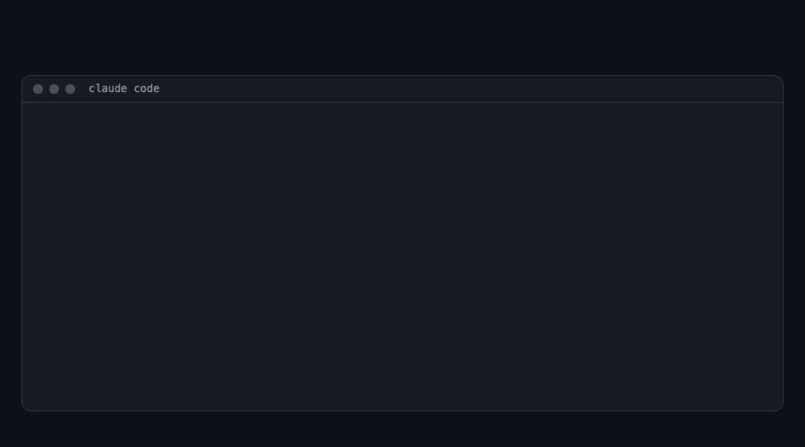

# nomore

**Stop telling Claude Code the same thing twice.**

We read nearly 10,000 Claude Code GitHub issues about how the model behaves, and turned the most-upvoted complaints
into 20 ready `CLAUDE.md` rules. Install them in 10 seconds. Then let `npx nomore` find the things *you* keep
repeating.



## Rule pack: 20 rules in 10 seconds

```bash
curl -fsSL https://raw.githubusercontent.com/globalmpc/nomore/master/rules/CLAUDE.md -o nomore-rules.md
```

Then add one line to your `CLAUDE.md`: `@nomore-rules.md` (or put both in `~/.claude/` for every project). Every rule
links to the issues behind it. Delete any you don't want; downloading again replaces the file.

Top 5:

- Don't add code comments unless they explain something non-obvious; match the comment density of the surrounding code, and stop when asked.
  1 issue · 252 reactions · [#65961](https://github.com/anthropics/claude-code/issues/65961)
- Don't use the word "load-bearing" or other recurring jargon; say what you mean in plain words.
  1 issue · 185 reactions · [#53454](https://github.com/anthropics/claude-code/issues/53454)
- Never run destructive git commands (`reset --hard`, `checkout -- .`, `clean -f`, `push --force`) or schedule them without explicit permission.
  1 issue · 121 reactions · [#40710](https://github.com/anthropics/claude-code/issues/40710)
- Keep typographic characters (curly quotes, em dashes, ellipses) exactly as written; don't replace them with ASCII.
  1 issue · 61 reactions · [#1599](https://github.com/anthropics/claude-code/issues/1599)
- Don't use the idiom "belt-and-suspenders"; vary phrasing and keep it literal.
  1 issue · 43 reactions · [#61462](https://github.com/anthropics/claude-code/issues/61462)

How they were chosen: every `anthropics/claude-code` issue labelled `area:model` or `data-loss`, fetched
2026-10-24 (7,994 after dropping pull requests, duplicates and withdrawn reports). The 7,897 with words in their
title were grouped by title similarity ≥ 0.5 and ranked by Σ(1 + reactions); 20 behaviours a `CLAUDE.md` rule can
change were then picked by hand, from issues still open or closed as not planned. Each rule currently rests on one
issue and its upvotes. Reproduce with `bash scripts/fetch-issues.sh && pnpm mine`.

**If a rule saved you a correction, star the repo so others find it.** Know a rule that belongs here?
[Propose it](../../issues/new?template=propose-a-rule.md).

## CLI *(preview)*

Finds the instructions **you** keep repeating across your Claude Code sessions and suggests them as rules.

```bash
npx nomore                  # what you keep telling Claude (sessions active in the last 30 days)
npx nomore --apply          # pick suggestions one by one (yes / no / edit) and add them to CLAUDE.md
npx nomore --project .      # only this project; --apply then writes this project's CLAUDE.md
npx nomore --card           # a short summary to share: totals only
```

**Preview, honestly:** most things people repeat are tasks ("commit", "continue"), not lasting preferences. On our
team's sessions about a third of the suggestions were real rules, so you choose what to keep; nothing is written
without your yes; rules you already have (including `@`-imported files like the rule pack) are recognised.
Filters are tuned for English, Korean and Indonesian. If nothing repeats yet, it points you to the
rule pack above.

Runs locally on Node 20+. It reads your Claude Code transcripts (respects `CLAUDE_CONFIG_DIR`), sends nothing
anywhere, and writes only the `CLAUDE.md` you choose plus a small log of adopted rules.

## Contributing

Rules, wrong suggestions and code are all welcome: see [CONTRIBUTING.md](CONTRIBUTING.md).

## Development

```bash
pnpm install
pnpm test
```

## License

MIT
